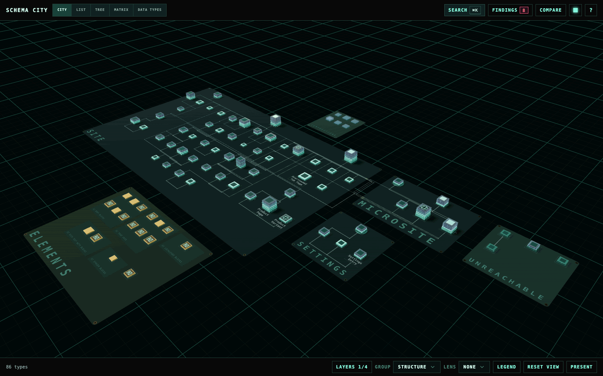
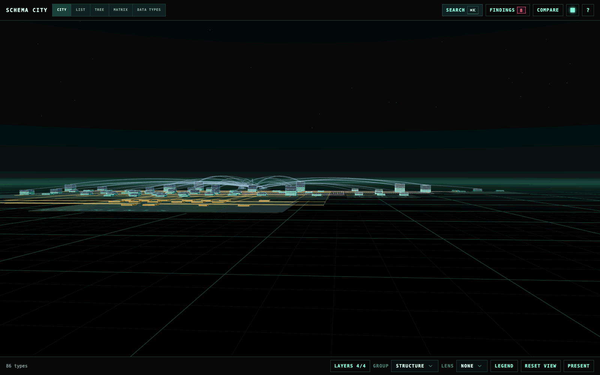
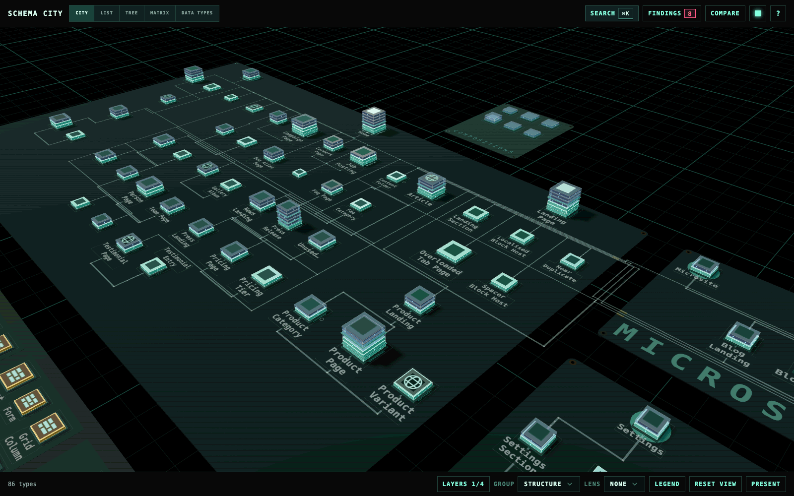

Before the city plan, Schema City was a city: buildings on glowing circuit boards, traces arcing between them, and a camera that flies in the first time it opens. It is the same schema, more fun to show a room than to work in. It still works in full, with the same panels around it: the inspector, List, Tree, Matrix, Data Types, Findings, Compare, Impact, Editor and Present. A site can switch it on with one setting.

**[Try the City demo](https://schema-city-demo.thebuilder.dk/city/)** in your browser. It needs no Umbraco install.



## Turn it on

Set `Variant` to `City` in `appsettings.json` and restart the site:

```json appsettings.json
{
  "SchemaCity": {
    "Variant": "City"
  }
}
```

The environment variable is `SchemaCity__Variant=City`.

- It applies to every user. There is no per-user switch.
- The Relationships tab in the Document Type editor shows the city too.
- `Clean` is the default and shows the city plan. Any other value also shows the plan.
- Earlier versions had only the city, so after an upgrade users open on the city plan unless the site sets this.

The city needs WebGL. Where the browser cannot start it, the canvas says so and the header and the other views keep working.

## How the city shows your schema

| In the city | In your schema |
| --- | --- |
| Board | A type allowed at root and everything it can create. Element Types, compositions and unreachable types get a board each. |
| Building | A Document Type or Element Type. Bigger buildings have more properties. |
| Floor | A property group |
| Trace | An allowed child, a composition, a block target or a picker reference |

## Move the camera

The city opens on a raised three-quarter view of the whole schema. The first time you open it in a browser, the camera flies in and a short hint shows over the canvas. The Relationships tab skips that opening. The flight respects your reduced-motion setting.

From there you can orbit, pan, move toward any point and come down to street level. If you lose the city, press <kbd>Home</kbd> or choose **Reset view** in the footer to frame it again. Focusing a type, leaving focus and Home fly the camera to the new framing.

| Action | Control |
| --- | --- |
| Orbit | Drag, or <kbd>[</kbd> and <kbd>]</kbd> |
| Tilt | Drag, or <kbd>Page Up</kbd> and <kbd>Page Down</kbd> |
| Move toward the cursor, or away | Mouse wheel |
| Pan along the ground | Right-drag, Shift-drag (works on a trackpad), <kbd>W</kbd> <kbd>A</kbd> <kbd>S</kbd> <kbd>D</kbd> or arrow keys |
| Rise and descend | <kbd>R</kbd>, <kbd>F</kbd> |
| Move faster | Hold <kbd>Shift</kbd> with a movement key |
| Reframe the city or leave focus | <kbd>Home</kbd>, or **Reset view** in the footer |

The keys that work in both looks, such as Search, the layers and the views, are on [Navigate the city plan](/navigation#keys-in-every-view). Press <kbd>?</kbd> in the city for its full list.



## Read the boards and buildings

The city is drawn as circuit boards. Each board is a district of related types, and each building on it is a type.

| What you see | What it means |
| --- | --- |
| A bigger building | More properties. The side grows with the square root of the count, so a few large types do not push the city apart. |
| A slab | One property group. A thin board between slabs marks where a new tab starts. |
| Lit windows | The group's properties |
| Translucent azure slabs | Groups that come from a composition. A composition nothing creates content from is made of these alone. |
| A low amber block | An Element Type |
| Pins along the base | Direct connections. Allowed parents are on the north edge, allowed children on the south, links out on the east and links in on the west. |
| A lit lid | The type has a template |
| A dot on the roof | The type varies by culture. A second dot means it varies by segment too. |
| A gold strip on a board's edge | A lane of traces leaving for another board |
| A small ring on a trace | A point where the trace turns |

**Legend** in the footer lists these too.

Hovering or selecting a building shows its direct connections on every layer, including the layers you have switched off.

## Read the names on the boards

Each type's name is printed on the board beside its building. From the overview, most names are already readable, and the floating label and the inspector always have the full name.

- Where names would collide, larger types and types with more content print first. Move closer and the rest appear.
- Names stay put while you pan, orbit and hover.
- A long name wraps onto two lines, then drops words its board already says, such as "Element" on the Elements board. It is never cut inside a word, and never shortened so far that it could be confused with another name on the same board.
- A name too small to read fades out, and fades back in as you come closer.
- In presentation mode, printed names keep their larger size longer as the camera comes closer, and the overview still prints every name that reads.



## Where its tools are

**Layers**, **Group**, **Lens**, **Legend** and **Reset view** are in the footer while the City view is on. Where the workspace is narrower than about 960 px, they fold into one **City tools** menu. A lens's colour key, and the key for what **Show in city** lit, sit in the top-left corner of the canvas.

On the Elements board, each block editor's Element Types stand on a lighter patch with the editor's Data Type name printed along its south edge, even when the editor offers only one type. A type no block editor offers stands on bare board.

## Change the phosphor colour

The square colour button in the header opens the **Phosphor** menu, which sets the colour the whole screen glows in: Green, which is the default, Orange, Yellow, Blue, Umbraco, Magenta or Grey. The choice is kept per browser.
