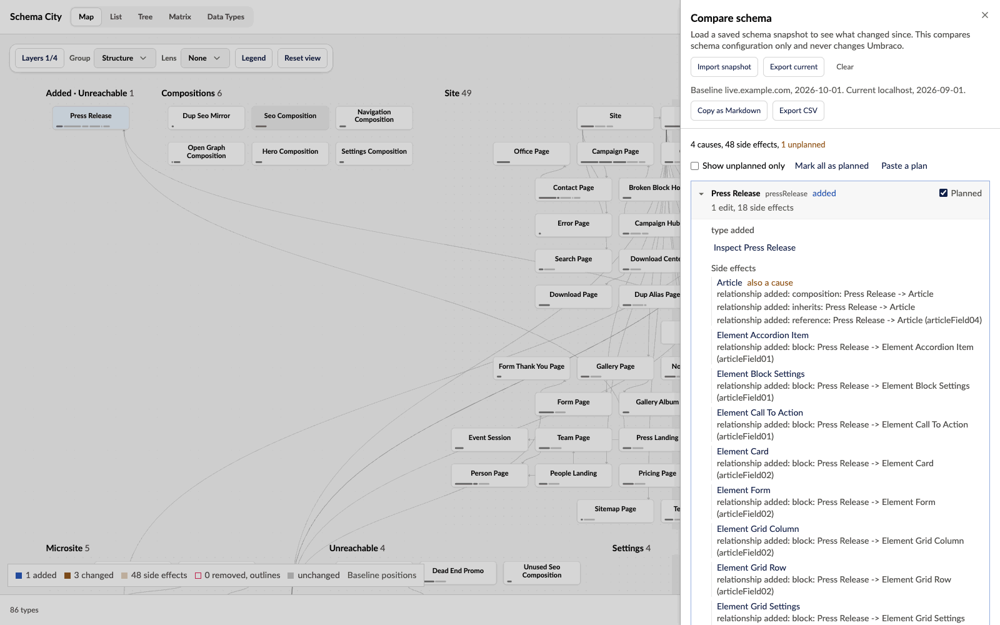

Compare shows what changed between the current schema and a saved snapshot. Open Compare and export the current schema before you make a change. The file is named after the site and the day, such as `schema-city-snapshot-example-com-2026-10-07.json`, and records the host it came from. Later, import that file as a baseline, or import a snapshot from another environment.

Snapshot import is for review and does not apply changes to Umbraco. Comparison covers schema configuration only. It does not compare content usage or dependencies in custom code.

## Causes and side effects

The comparison is a list of causes. A cause is one type with edits of its own. Those edits are:

- the type was added or removed
- properties were added, removed or changed, or a property got a new Data Type
- its groups or tabs changed
- its compositions, allowed children, or block or picker targets changed

The types that only changed because of a cause are its side effects, and sit under it:

- every type that composes or inherits a composition whose properties changed
- every Element Type whose incoming block relationship changed because a host's block list did
- every type whose incoming picker or allowed-child relationship changed, and every parent that gained or lost an allowed child because that child type was added or removed

A type with an edit of its own and a side effect too stays a cause, and says what else it is a side effect of. Nothing is dropped. Every line of the comparison sits under exactly the causes that explain it, and a line nothing explains counts as its type's own edit. The summary reads, for example, "4 causes, 48 side effects, 1 unplanned", where the old flat list said "1 added, 51 changed".

## Mark what you planned

Tick each cause you planned with its Planned box, use Mark all as planned, or Paste a plan as a list of type aliases. Show unplanned only then leaves the changes nobody asked for. The plan lasts as long as the baseline does.

- Copy as Markdown gives a ticket-ready list, with both snapshots' hosts and dates, the totals, each cause ticked when planned, and its side effects nested under it.
- Export CSV gives one row per line, with the cause it belongs to, whether it is the cause's own edit or a side effect, and whether it was planned.

## See the changes in the city

While a baseline is loaded, the city shows a change layer and dims everything else:

- added types are azure
- types changed by their own edit are amber with a ring
- side effects are a quieter amber
- removed types are outlines where they stood

Choosing a lens replaces the change layer until the lens is off again. Show in city, from the Impact page or a Data Type, replaces it until you clear it. The List view gets a Change column, sortable and filterable, with a row for each removed type.

Matched buildings keep their baseline positions. New types appear on separate added boards.

