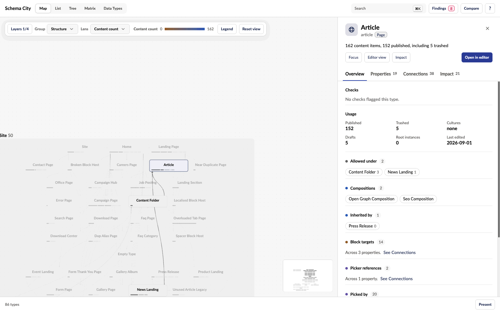

**Lens** in the map toolbar colours every card by one measure of the content stored for it. The colour goes on the card's icon and tile, with a light wash over the card. Select a type to read its exact counts in the inspector.

| Lens | Colours each type by |
| --- | --- |
| Content count | How many content items of the type exist |
| Published share | How much of the type's content is published. A type with no content stays uncoloured. |
| Cultures | How many cultures the type's content exists in |
| Incoming references | How many references from other content point at the type's content |
| Unused | Whether the unused checks in [Findings](/findings) flag the type. A type counts as in use when it has content, a type composes it or a block editor lists it. |

The counting lenses stretch their colours over the values your site actually has, so a difference still shows when every type has thousands of items. Element Types go quiet under the lenses about content items, since they hold none of their own. A key beside **Lens** in the map toolbar names the lens and the values at each end of its colour scale. In the 3D city the lens colours the buildings, and the key sits in the top-left corner of the canvas.

Usage loads separately from the schema, so you can explore the model while that request is pending. Usage is a snapshot, cached on the server for one minute. It is not a live dependency check.

## Configured and observed references

A picker's configuration says which Document Types it allows. Content says which items it actually links to. These are different data, and the inspector's Connections tab reports them separately, under Picker references and Observed in content.
