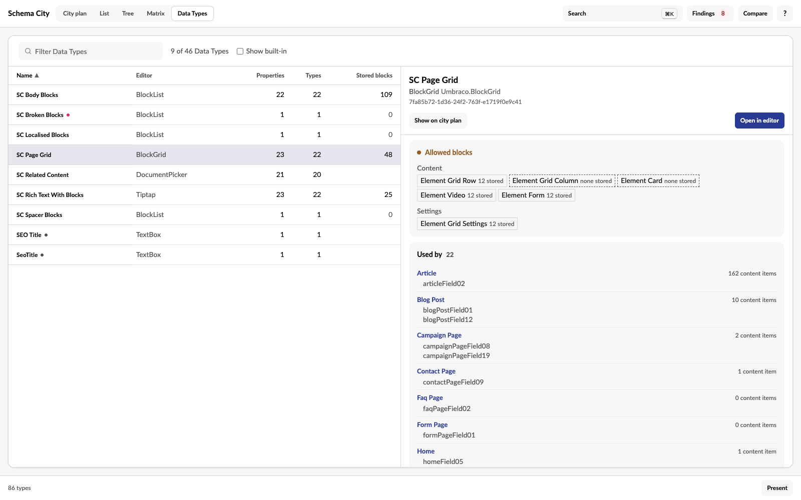

**Data Types** in the view switcher lists every Data Type in the site, unused ones included. Choose one to read its page beside the list, or under it when the room is narrow. The URL keeps it as `dataType=<key>`.

Each row shows the Data Type's editor, how many properties use it, on how many types, and the blocks content stores in it. A dot marks one that a check flagged. Sort by any column, and filter by name, editor or key.

The Data Types Umbraco installs itself are marked built-in. They stay out of the list until you tick **Show built-in**, except one that a link has opened.

Every Data Type name elsewhere in the app opens this page:

- the column headings of the Matrix's Data Types grid
- the Editor page's property rows
- the inspector's Properties tab, and its block and picker sections
- Data Type changes in Compare
- findings that name a Data Type

## Read a Data Type's page

The page shows the editor's UI alias, its editor alias and its key. **Open in editor** opens the Data Type in the backoffice.

- A block editor lists the Element Types it offers as content and as settings, each with the blocks of it that content stores. You can see what a move or a removal would touch before you make it. An offered Element Type that nothing stores has a dashed edge and says none stored. A key that no longer resolves says missing type. An Element Type that content still stores but the editor no longer offers gets its own row.
- A picker lists the Document Types it allows.
- Used by lists every type with a property on it, with the property aliases, the composition a composed one comes from and the type's content count. A property's name follows its alias only when it says more than the alias, and a type is marked only when it is an Element Type or a composition. Choose a type to open it in the inspector.
- The page ends with the stored block totals, a few configuration values such as a block list's limits, and the findings about the Data Type.

**Show on city plan** switches to the city plan and lights the cards that use the Data Type. **Clear**, in the key that says what is lit, ends it, and so does choosing a lens. In the 3D city the button is **Show in city**.

Stored blocks are counted with the usage snapshot. The count covers the latest version of every document outside the recycle bin, published or draft, nested blocks included. It reads the stored JSON directly and stops after 50,000 values or five seconds. The page then says the numbers are a lower bound. Media and member values are not counted.

