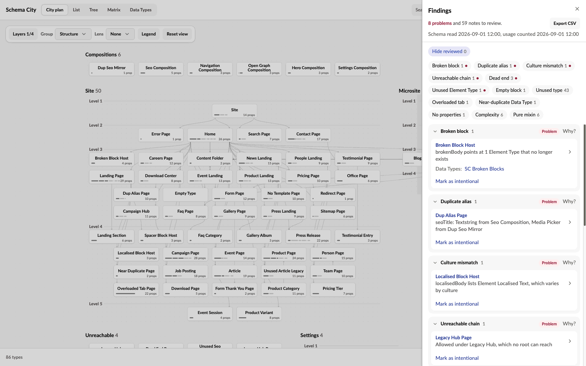
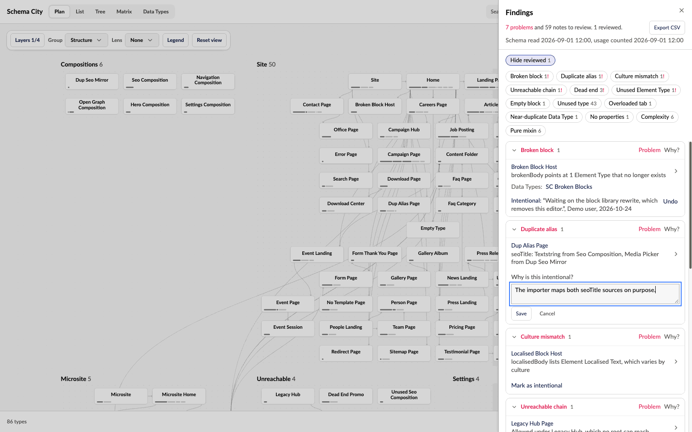

**Findings** in the header checks the schema and lists what it finds, from blocks that point at a deleted Element Type to types no editor can reach. Filter by kind, select a row to inspect the type with its related types, and record a decision on the ones that are deliberate. The drawer's header says when the schema was read and when the usage was counted.

Each finding is either a problem or a note.

- **Problems** are open in the drawer and marked with a pink dot across the app. Something is broken, or an editor cannot use the type as intended.
- **Notes** are collapsed. They are worth knowing, and often deliberate.

Results are grouped by kind, in the order of the table below, so what is definitely broken comes first. Each group names its kind, and **Why?** on its header says what the kind means and what to do next. Click a row to open its type. Within a group the strongest cases come first, for example an unused type whose allowed parents have no content either.

## What the checks flag

| Check | Kind | What it means |
| --- | --- | --- |
| Broken block | Problem | A block editor lists an Element Type that no longer exists. Once usage has loaded, the row says how many blocks of it content still holds. |
| Orphaned blocks | Problem | Content stores blocks of an Element Type that no block editor lists any more. It takes the place of the Unused Element Type row once usage has loaded, and names the Data Types the blocks are stored in. |
| Duplicate alias | Problem | A property alias arrives from more than one place, the type's own properties or its compositions. |
| Culture mismatch | Problem | An invariant type has a property that varies by culture, or a block editor that lists an Element Type that varies by culture. |
| Unreachable chain | Problem | A type is allowed under other types, but no root leads to any of them. |
| Dead end | Problem | A type is not allowed at root or under any type, is not an Element Type, and nothing composes it. |
| Unused Element Type | Problem | No block editor lists the Element Type. Once usage has loaded, the row says how many blocks of it content stores. |
| Empty block | Note | An Element Type offered as a content block has no properties. A divider or spacer block is often empty on purpose. |
| Unused type | Note | The usage snapshot counts no content of the type, though an editor can create it. Often the content is not written yet. Needs usage to have loaded. |
| Overloaded tab | Note | A tab holds more than 20 properties, composed ones included. On a type without tabs, a group does. |
| Near-duplicate Data Type | Note | Data Types whose names match once case, spaces, hyphens, underscores and a copy number such as (1) are ignored. Each set is one note, on a type that uses the least-used of them. |
| Unused Data Type | Note | No property on a Document, Media or Member Type uses the Data Type, and no collection view either. The Data Types Umbraco installs itself are left out. |
| No properties | Note | The type has no properties of its own or from compositions. |
| Complexity | Note | The type's score, from its properties, compositions and block targets, is within a fifth of the busiest type. |
| Pure mixin | Note | The type is only used as a composition and never created on its own. |
| No template | Note | An editor can create the type, but no template is allowed. Left out on a type already reported as unused, and when more than half the creatable types have no template, since that schema is headless by design. |

Rows that name a Data Type link to [its page](/data-types).

:::caution[A finding is a reason to look]
It is not permission to delete. An unused Document Type has no content in the usage snapshot, and an unused Element Type has no block editor that lists it and, once usage has loaded, no stored blocks. A count that stopped early says so. Custom code, migrations, external consumers, and media or member values can still depend on either.
:::

## Export findings as CSV

**Export CSV** saves the filtered results as one header row and one row per finding, ready for an Excel or Jira import.

<Expandable title="The columns, in order">

- the kind
- the type, with its key, folder, content counts and backoffice path
- the detail, explanation and next step
- related types by name
- Unused branch root, which for an unused type names its topmost unused ancestor, so a branch of unused types can go in one ticket
- the filter used, and the schema and usage snapshot dates
- the Data Types the finding names, with names and keys in two columns
- the review status, reason, who decided, when, and whether it reopened

</Expandable>

A finding about a Data Type alone leaves the type columns blank and gives the Data Type's backoffice path.

## Mark a finding as intentional

Mark a deliberate finding as intentional so it stops asking for attention. Examples are a spacer block with no properties, a mixin kept for one type, or a type an import still reads.

**Mark as intentional** is on each row, in the inspector's checks and on a Data Type's page. It asks for a reason of up to 500 characters and records it with your name and the date. The row then reads "Intentional:" with the reason, and **Undo** removes the decision.

**Hide reviewed** is on by default. It takes decided rows out of the drawer, so the list shrinks to what still needs attention. The header counts both, for example "67 findings, 12 reviewed, 55 open". A row you decide stays in view until the drawer closes.

A reviewed finding goes quiet in the rest of the app too:

- In the List, the Tree and the Data Types list, its dot becomes a hollow grey ring whose label starts "Reviewed:".
- The inspector's Overview tab and a Data Type's Findings heading count open findings only, and give the reviewed ones separately, for example "1 reviewed". The "!" marks open problems only.
- Reviewed checks stay listed, greyed out, after the open ones, so you can still read the reason or Undo it.
- The Unused lens and the Editor page's flagged property rows count open findings only.

A reopened finding counts as open again in all of these.

## When a decision reopens

A decision holds only for the schema as it was when it was made. When the type or Data Type the finding is about changes, the finding is open again. It shows the old decision and "Reopened: the type changed since this was decided."

Each decision stores a fingerprint of that type or Data Type. The fingerprint covers its own settings, its groups and properties, its templates, and every connection in or out of it, allowed children, compositions and block targets included. Renaming the type, or a Data Type it uses, reopens the finding too, since the check errs towards asking again. Saving checks the fingerprint on the server, so a decision is never recorded against a type that changed after the page loaded.

## Where decisions are stored

Decisions are app data, not schema.

- Each finding gets one row in Umbraco's key-value table (`umbracoKeyValue`), stored as JSON under `SchemaCity.Decision.<finding id>`. The package needs no migration, and nothing in the Document Types, Data Types or content changes.
- Undo empties the row rather than deleting it, because Umbraco's key-value service has no delete.
- Everyone who opens Schema City on that site shares the decisions. They do not travel with a schema snapshot or uSync.
- Recording and undoing need the same Settings section access as the rest of the extension.
