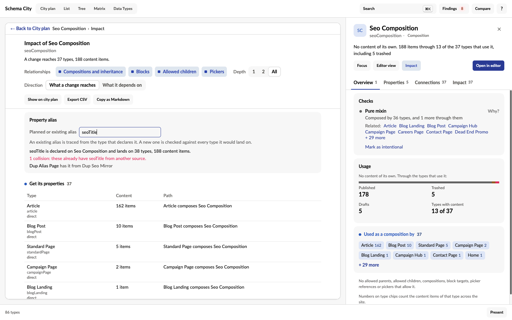

Impact answers "if I change this type, what else changes?" It lists every type a change to the selected type reaches, with the path to each one and its content count.

The inspector's **Impact** tab lists them by group. **Impact** at the top of the inspector, or <kbd>I</kbd>, opens the full trace in place of the view.

The trace follows four relationships, each with its own toggle:

- **Compositions and inheritance.** Every type that gets the type's properties, directly or through a type that inherits or composes it. Press Release reaches Seo Composition through Article.
- **Blocks.** For an Element Type, every type whose properties offer it, with the property and its Data Type. Then the types that inherit those properties, and the blocks that nest it. The header says how many blocks of it content stores, per Data Type.
- **Allowed children.** The types that allow it as a child and would lose a creation option. Also the allowed children that only it leads to from a root, which nobody could create if it were removed.
- **Pickers.** The types whose picker properties allow it, and the types that carry those properties.

**Depth** stops the trace after one step or two, or with **All** follows it all the way. **Direction** turns the trace round, from What a change reaches to What it depends on: its compositions, the blocks it offers, the types allowed under it and the types its pickers allow.

Each row writes out its paths in words, shortest first, up to three, such as "Press Release inherits Article, which composes Seo Composition". It also says whether the type is reached directly. A path never visits a type twice, so cycles end. The totals at the top count each type once.

**Templates that render them** lists the templates allowed on the type and on every type a change reaches, with how many of those types use each, so you know which Razor views to open.

## Check a property alias

Adding a property to a composition can collide with a property of the same alias on a type that composes it. **Property alias** checks for that before you make the change.

- An alias the type has is traced from the type that declares it, and lists every type it lands on.
- A new alias is checked against every type it would land on if added here.

Either way, a type that already has the alias from another source is a collision. Umbraco compares aliases without case, and a type cannot hold one twice. On the Editor page, each property row's Impact opens the trace with its alias filled in.

## Share the trace

- **Copy as Markdown** copies a ticket-ready summary. It has the start type, the relationships and depth, the snapshot dates, the totals, a table per group with each path and content count, the templates and the collisions. Where the clipboard is blocked, the text is shown selected instead.
- **Export CSV** writes one row per type per group, one per type per template and one per collision. It uses the same escaping and spreadsheet formula protection as the findings export.
- **Show on city plan** lights the type and everything the trace reaches on the city plan. In the 3D city it is **Show in city**.

:::note
A trace lists configured relationships to review. It does not tell you a change is harmless, or that it breaks something. Code, templates and stored values outside the schema can depend on a type too.
:::

