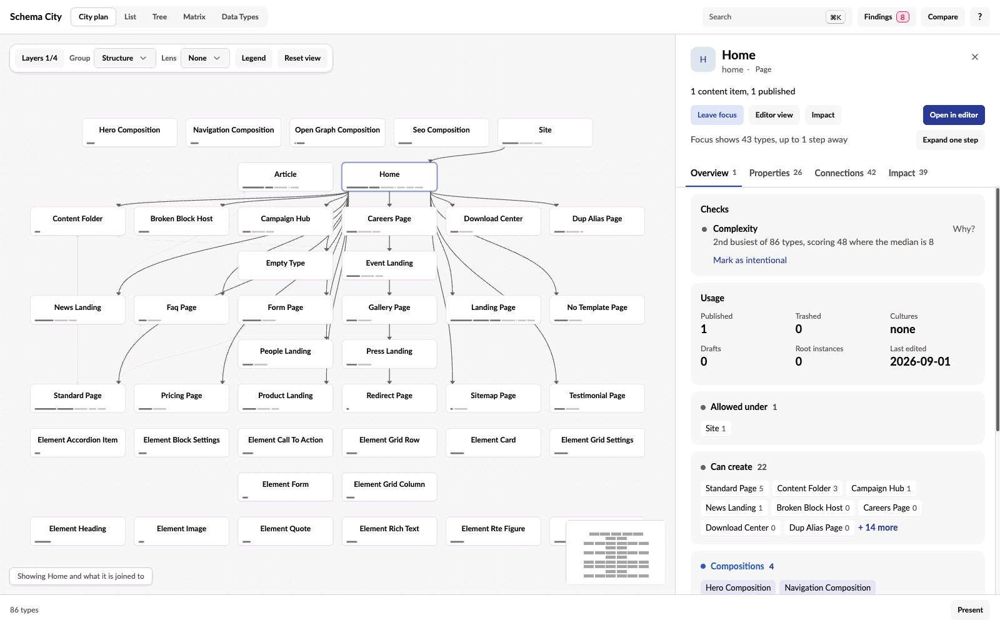

Most questions about a type start the same way: find it, see what it connects to, then focus on its neighbourhood.

1. **Find it.** Press `⌘K` / `Ctrl+K`, or use **Search**, and type a name, alias or property alias.
2. **Hover it.** The building shows its direct connections, and the names of unrelated types dim.
3. **Select it.** Click the building to keep its connections visible and open the inspector.
4. **Focus on it.** Double-click the building, or press Enter, to bring its neighbours together. See [Focus on a neighbourhood](#focus-on-a-neighbourhood).

## Read the inspector

The inspector's header names the type, its role (page, composition or Element Type) and how much content uses it. **Editor view** and **Impact** open the [Editor](/views#read-a-type-as-an-editor-sees-it) and [Impact](/impact) pages for the type, and **Open in editor** opens the Document Type in Umbraco.

The inspector has four tabs. Every type opens on Overview.

| Tab | What it shows |
| --- | --- |
| **Overview** | The checks that flag the type, its usage and its related types |
| **Properties** | Each group with the composition it comes from, and each property's Data Type |
| **Connections** | Every configured connection by kind, and block and picker targets by property. References counted in content are listed separately, under Observed in content. |
| **Impact** | What a change to the type reaches. See [Trace the impact of a change](/impact). |

Click a related type to select it instead. The number on a type chip is how many content items of that type the site has. Under Observed in content, it is the number of references instead.

To see what a connection means, click it, or use **Explain connections** at the end of the Connections tab.

## Read the boards and buildings

The city is drawn as circuit boards. Each board is a district of related types, and each building on it is a type.

| What you see | What it means |
| --- | --- |
| A bigger building | More properties. The side grows with the square root of the count, so a few large types do not push the city apart. |
| A slab | One property group. A thin board between slabs marks where a new tab starts. |
| Lit windows | The group's properties |
| Translucent azure slabs | Groups that come from a composition. A composition nothing creates content from is made of these alone. |
| A low amber block | An Element Type |
| Pins along the base | Direct connections. Allowed parents are on the north edge, allowed children on the south, links out on the east and links in on the west. |
| A lit lid | The type has a template |
| A dot on the roof | The type varies by culture. A second dot means it varies by segment too. |
| A gold strip on a board's edge | A lane of traces leaving for another board |
| A small ring on a trace | A point where the trace turns |

**Legend** in the footer lists these too.

## Read the names on the boards

Each type's name is printed on the board beside its building. From the overview, most names are already readable, and the floating label and the inspector always have the full name.

- Where names would collide, larger types and types with more content print first. Move closer and the rest appear.
- Names stay put while you pan, orbit and hover.
- A long name wraps onto two lines, then drops words its board already says, such as "Element" on the Elements board. It is never cut inside a word, and never shortened so far that it could be confused with another name on the same board.
- A name too small to read fades out, and fades back in as you come closer.

## Switch connection layers

**Layers** in the footer, or the keys 1 to 4, choose which connections the city draws. Hovering or selecting a type always shows its direct connections, including those on layers you have switched off.

| Layer | Key | Relationship |
| --- | --- | --- |
| Structure | 1 | Which Document Types can be created below another type |
| Compositions | 2 | Shared compositions and inheritance |
| Blocks | 3 | Element Types configured as block content or settings |
| References | 4 | Document Types allowed by configured pickers |

## Focus on a neighbourhood

Focus gathers the selected type and its neighbours in one place. To focus, double-click a building, press Enter with a type selected, or choose **Focus** in the inspector.

- **Expand one step** adds the next ring of connected types, and leaves the ones already there in place.
- Closing the inspector, or clicking bare ground, clears the selection but keeps the neighbourhood on screen.
- **Leave focus** in the inspector, Escape, Home or **Show all** leave focus. With a type selected, the first Escape leaves focus and the second clears the selection.
- While focus is on, List, Tree and Matrix show only the focused types, with a line above them offering **Show all**.

