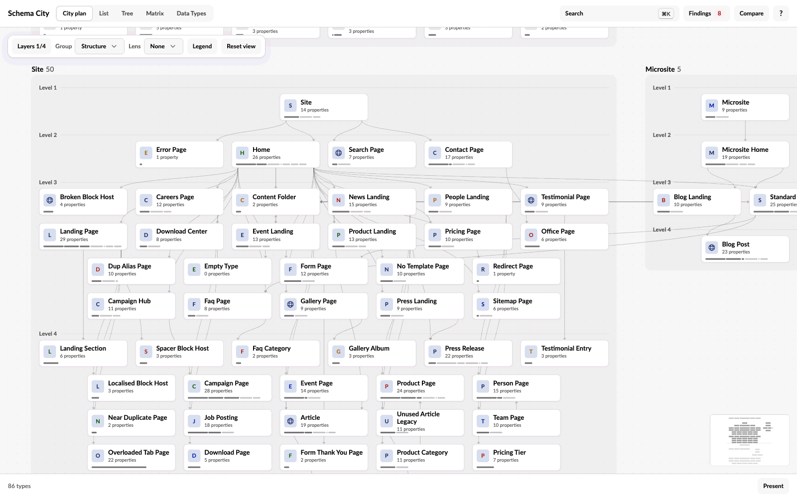

Most questions about a type start the same way: find it, see what it connects to, then focus on its neighbourhood.

<Steps>
  <Step title="Find it">
    Press <kbd>⌘</kbd> <kbd>K</kbd> or <kbd>Ctrl</kbd> <kbd>K</kbd>, or use **Search**, and type a name, alias or property alias.
  </Step>
  <Step title="Hover it">
    With nothing selected, its lines light up and the cards it is not joined to fade.
  </Step>
  <Step title="Select it">
    Click the card to keep its lines lit and open the inspector beside the plan.
  </Step>
  <Step title="Focus on it">
    Double-click the card, or press <kbd>Enter</kbd>, to bring its neighbours together. See [Focus on a neighbourhood](#focus-on-a-neighbourhood).
  </Step>
</Steps>

## Read the inspector

The inspector's header names the type, its role (page, composition or Element Type) and how much content uses it. **Editor view** and **Impact** open the [Editor](/views#read-a-type-as-an-editor-sees-it) and [Impact](/impact) pages for the type, and **Open in editor** opens the Document Type in Umbraco.

The inspector has four tabs. Every type opens on Overview.

| Tab | What it shows |
| --- | --- |
| **Overview** | The checks that flag the type, its usage and its related types |
| **Properties** | Each group with the composition it comes from, and each property's Data Type |
| **Connections** | Every configured connection by kind, and block and picker targets by property. References counted in content are listed separately, under Observed in content. |
| **Impact** | What a change to the type reaches. See [Trace the impact of a change](/impact). |

Click a related type to select it instead. The number on a type chip is how many content items of that type the site has. Under Observed in content, it is the number of references instead.

To see what a connection means, click it, or use **Explain connections** at the end of the Connections tab.

## Read the cards and lines

Each type is a card in a district. The districts are soft grey trays, each named above with how many types it holds.

| What you see | What it means |
| --- | --- |
| The icon | The type's own icon from Umbraco, on a tile whose tint tells pages, compositions and Element Types apart |
| The line under the name | How many properties the type has, its own and from compositions. An Element Type says Element first. |
| The size bar along the card's foot | One segment per property group, each as long as the group's properties, so a longer bar is a bigger type. Segments from a composition are fainter. Past 12 groups the bar is one solid stretch. |
| A line between cards | A connection, in the colour of its layer. Blocks are dotted and picker references dashed. |
| A ring round a card | The selected type |

Hover a card for its full name and its size, as "N groups · N properties". **Legend** in the toolbar lists the cards and lines too.

Lines curve from row to row and stay faint until you hover or select a card. Then that card's lines light up and everything it is not joined to fades. The cards in each row are ordered so that as few lines cross as possible.

Zoomed out, a card shows less, down to a tile with only its size bar. See [Zoom out](/navigation#zoom-out).

## Switch connection layers

**Layers** in the toolbar, or the keys <kbd>1</kbd> to <kbd>4</kbd>, choose which connections the plan draws. Structure is on by default. Hovering or selecting a card lights its lines on the layers that are on. In the 3D city, it shows direct connections on every layer, including those switched off.

| Layer | Key | Relationship |
| --- | --- | --- |
| Structure | <kbd>1</kbd> | Which Document Types can be created below another type |
| Compositions | <kbd>2</kbd> | Shared compositions and inheritance |
| Blocks | <kbd>3</kbd> | Element Types configured as block content or settings |
| References | <kbd>4</kbd> | Document Types allowed by configured pickers |

## Focus on a neighbourhood

Focus shows the selected type and its neighbours on their own. To focus, double-click a card, press <kbd>Enter</kbd> with a type selected, or choose **Focus** in the inspector.

- A note in the bottom-left corner of the plan names the type the neighbourhood is gathered round.
- **Expand one step** adds the next ring of connected types.
- Closing the inspector, or clicking empty space, clears the selection but keeps the neighbourhood on screen. A small card in the top-right corner then names the focused type: click the name to select it again, or choose **Leave focus**.
- **Leave focus** in the inspector or on that card, <kbd>Esc</kbd>, <kbd>Home</kbd> or **Show all** leave focus. With a type selected, the first <kbd>Esc</kbd> leaves focus and the second clears the selection.
- While focus is on, List, Tree and Matrix show only the focused types, with a line above them offering **Show all**.

