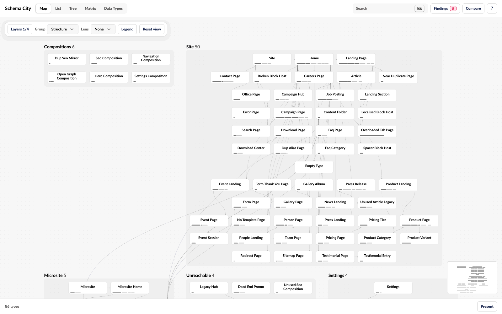

Schema City shows your Umbraco content model as a map, right in the backoffice. Each Document Type is a card, grouped into districts by where editors can create it. Lines between cards show allowed children, compositions, block targets and picker references. Use it to understand a schema before you change it.

**[Try the demo](https://schema-city-demo.thebuilder.dk)** in your browser. It needs no Umbraco install.

## How the map shows your schema

| On the map | In your schema |
| --- | --- |
| District | A type allowed at root and everything it can create. Compositions, Element Types and unreachable types get a district each. |
| Card | A Document Type or Element Type, with its icon, name and property count |
| Size bar | The type's property groups along the foot of its card, one segment per group, each as long as its properties |
| Line | An allowed child, a composition, a block target or a picker reference |

:::note[Read-only]
Schema City never changes your Document Types, Data Types or content. The only thing it writes is the decisions you record on findings.
:::

## What you can do with it

- **Find your way around a schema.** Search by name, alias or property alias, hover a card to see what it connects to, and focus on a type and its neighbours. See [Investigate a type](/investigate-a-type).
- **Catch problems before they ship.** Findings checks the schema for blocks that point at deleted Element Types, duplicate aliases, unused types and Data Types, types no editor can reach, culture mismatches and overloaded tabs. See [Review findings](/findings).
- **See what content uses.** Colour the cards by content count, published share, cultures, incoming references or unused types. See [Check content usage](/content-usage).
- **Know what a change will touch.** Impact lists every type a change reaches, with the path to each one and its content count. See [Trace the impact of a change](/impact).
- **Compare environments.** Export a snapshot of the schema, then compare against it later or against another environment. See [Compare schema snapshots](/compare).
- **Read the schema without the map.** List, Tree, Matrix, Editor and Data Types show it as tables, a tree and pages, and work from the keyboard. See [Move between views](/views).
- **Show it to a room.** Presentation mode fills the screen with larger names, and a caption card replaces the inspector. See [Present the schema](/present).

## Good to know

- Treat a finding as a reason to look before you delete anything. Custom code, templates, migrations and external systems can depend on a type that no content uses.
- Usage counts are a snapshot, cached for one minute. Block counting stops after 50,000 values or five seconds, and the app says when it did.
- Decisions on findings are stored in Umbraco's `umbracoKeyValue` table, so the package needs no migration. Every user with Settings access sees the same decisions.
- The screenshots come from the demo, which has 86 types with problems planted on purpose. They show the app without the backoffice around it.

## Prefer it in 3D?

Schema City can draw the same schema as a 3D city instead, with a board for each district, a building for each type and a floor for each property group. A site turns it on for every user with one setting. See [Use the 3D city](/3d-city).
