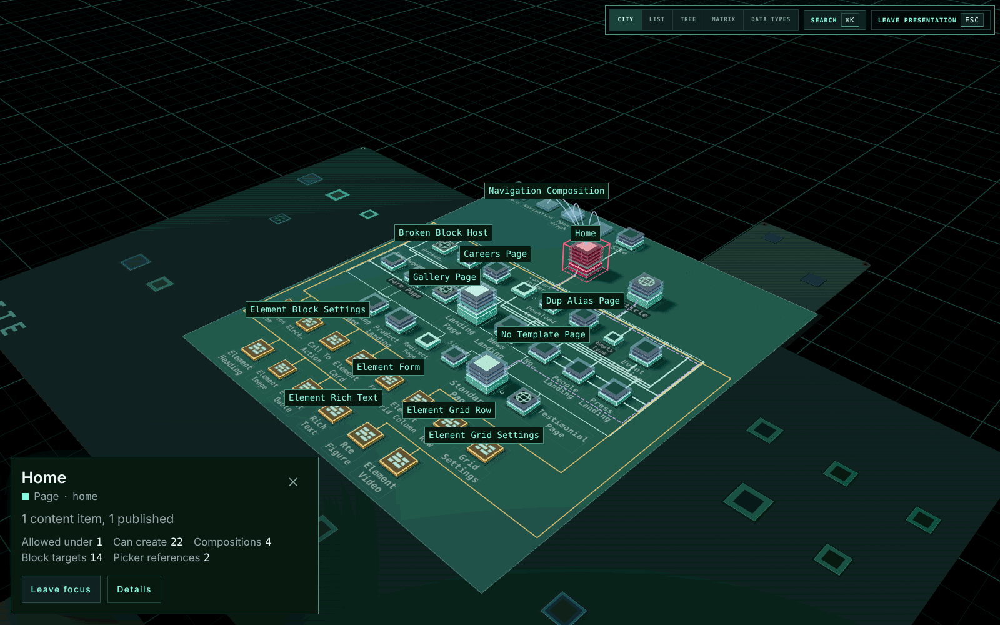

Press <kbd>P</kbd>, or choose **Present** in the footer, to show the schema to a room.

- Presentation mode takes the whole screen where the browser allows it. A backoffice that is not allowed to go full screen, or a link opened with `present=1`, fills the window instead. Press <kbd>P</kbd> twice for full screen.
- The header and the footer go.
- The names over and on the city, the 2D views, the legends and the inspector are drawn 1.4 times larger, so they read on a projector. The names printed on the boards keep their larger size longer as the camera comes closer, and the overview still prints every name that reads.

Move the mouse and a slim bar appears at the top right, with the views over the whole schema, **Search** and **Leave presentation**. It fades when the mouse rests, and <kbd>Tab</kbd> reaches it at any time.

Selecting a type shows a caption card in the bottom-left corner instead of the inspector. It gives the type's name and role, how much content it has, and how many types it has in each relationship. **Details** opens the full inspector over the view. Editor and Impact open from the card's Details. The camera frames on the whole screen either way. In the 2D views the last rows scroll clear of the card.

Closing the card, or clicking bare ground, puts the type down and keeps focus, as it does outside presentation. **Leave focus** on the card, or <kbd>Home</kbd>, leaves focus.

<kbd>Esc</kbd> closes **Details** first, then leaves presentation and keeps the focus, the selection and the view. Leaving full screen the browser's way leaves presentation too. Focus, Impact, Show in city, the change layer and lenses all work as they do outside it.

A typical run:

<Steps>
  <Step title="Start on the overview">Open the city on its view of the whole schema.</Step>
  <Step title="Focus a type">Search for a type and press <kbd>Enter</kbd> to focus it.</Step>
  <Step title="Show what a change reaches">Press <kbd>I</kbd> for its Impact, then **Show in city**.</Step>
  <Step title="Compare its compositions">Press <kbd>M</kbd> for the Matrix.</Step>
</Steps>

