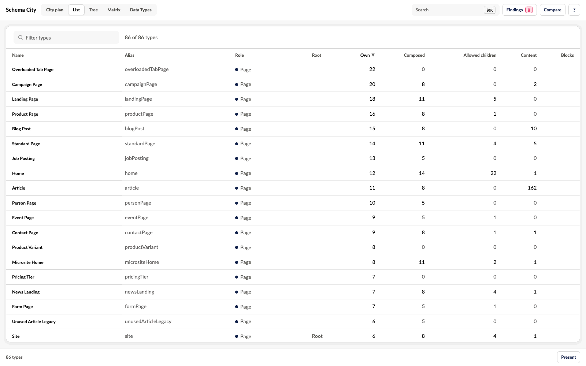
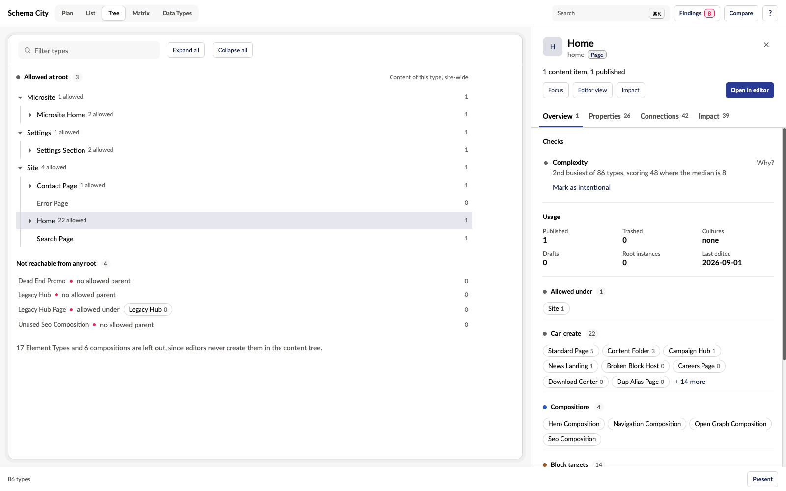
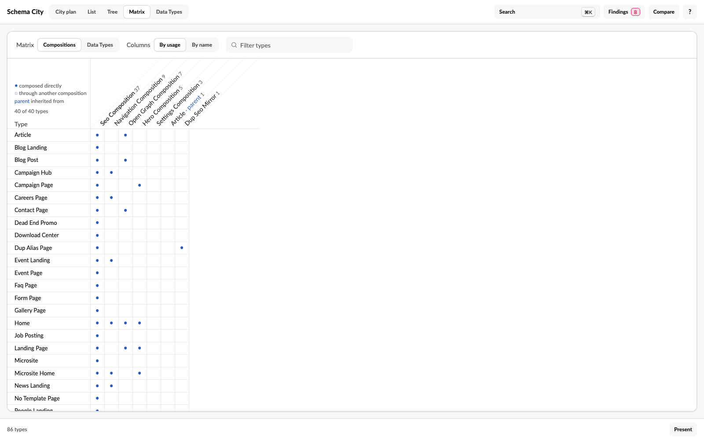
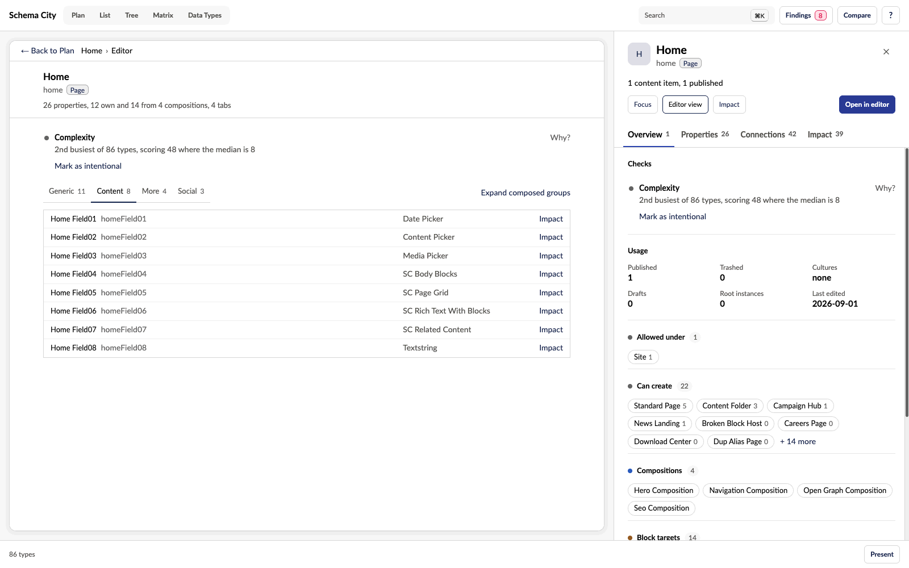

Schema City shows the same schema in several views. Every view except City plan shows it as tables, a tree or a page rather than on the city plan, and the chosen view is kept in the URL, so a link opens where you left off.

| View | What it shows | Key |
| --- | --- | --- |
| City plan | The schema as cards and lines. See [Investigate a type](/investigate-a-type). | |
| [List](#use-the-list-view) | Every type in a sortable table | <kbd>L</kbd> |
| [Tree](#follow-the-creation-tree) | What an editor can create under each root | <kbd>T</kbd> |
| [Matrix](#compare-types-in-a-matrix) | Which types use which compositions and Data Types | <kbd>M</kbd> |
| [Data Types](/data-types) | Every Data Type, with what uses it | |

L, T and M toggle back to the plan when pressed again. In the 3D city, the first view is called City.

Two more pages are about one type rather than the whole schema. Select a type and press <kbd>E</kbd> for its [Editor](#read-a-type-as-an-editor-sees-it) page or <kbd>I</kbd> for its [Impact](/impact) page, or use **Editor view** and **Impact** in the inspector. A line above the page names the type and leads back to the view you came from, with the selection kept. With nothing selected, E and I say "Pick a type first". A link to one of these pages opens it on the same type.

## Where things are

- **The header** holds the view switcher, then **Search**, **Findings**, **Compare** and the control reference.
- **The plan's toolbar**, over the top-left corner of the plan, holds its own tools: **Layers**, **Group**, **Lens**, **Legend** and **Reset view**. See [Use the toolbar](/navigation#use-the-toolbar). In the 3D city they are in the footer instead.
- **The footer** says how many types the schema has, and, on hover, when the schema and the usage were read. It says "usage loading" while that request is still out.
- **Present** is in the footer in every view. See [Present the schema](/present).

## Use the List view

List shows every type in a searchable, sortable table. Click a column heading to sort by it, or click a type to open the inspector.

Each type's role is shown in colour, and a dot marks a type with a problem finding. Content counts are blank for Element Types and for compositions nothing creates, as on the inspector's chips, since neither holds content of its own.

## Follow the creation tree

Tree shows what an editor can create under each root. It starts at each type allowed at root and follows the allowed-child rules.

- A type allowed under two parents appears under both.
- A type that already appears higher in the same branch is marked and not expanded again.
- Once usage has loaded, each type shows its content count across the whole site, on its first row only. A repeat of the type further down says same type.
- Types without content are drawn quieter, so the branches where content lives stand out.
- A dot marks a type with a problem finding, and its tooltip names the checks.

Below the tree, a list shows the Document Types that no root can reach, with the types they are allowed under. This shows a chain that only hangs off another unreachable type. Element Types and compositions that nothing can create are left out of that list.

## Compare types in a matrix

Matrix has two grids.

**Compositions** shows which types use which compositions, and marks a composition that arrives through another one. Umbraco records a parent type as a composition of the types that inherit from it, so a parent appears as a column too, marked parent.

**Data Types** shows how many of each type's own properties use each Data Type. Each column is headed by the Data Type name, with the property editor alias and the start of the Data Type key below it, so two Data Types with similar names can be told apart. Rows are sorted by name, and columns sort by usage or by name.

Click a row's name to select that type. Click a column header to select that composition, or to open that Data Type's page.

## Read a type as an editor sees it

Editor draws the selected type as tabs and groups, the way editors see it. Choose Editor view in the inspector, or press <kbd>E</kbd>, to open the selected type here.

- Tabs and groups come in the order the schema lists them.
- Each property shows its name, alias, Data Type, mandatory marker and culture variance. The property editor alias shows on hover, and a screen reader reads it after the Data Type.
- A group from a composition names the composition once on its header and starts folded, so the properties the type adds itself stand out. The view opens on the first tab that has any of them. Expand composed groups opens the folded groups.
- The type's checks sit above the tabs, and a tab with more than 20 properties is marked.
- Rows the checks are about are highlighted. These are both properties of a duplicate alias, with the editor each one uses, a block property that lists a deleted Element Type, and the properties of a culture mismatch. A folded group with such a row carries a dot.

